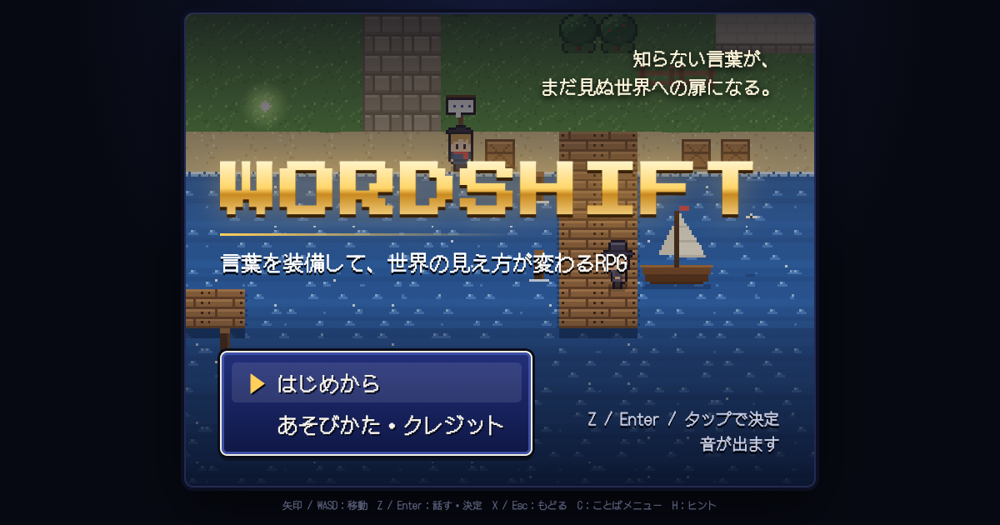

# WORDSHIFT ─ 言葉を装備するRPG

**▶ 遊ぶ：https://itosyun0805-pixel.github.io/wordshift/**（ブラウザで無料・インストール不要・スマホ対応）



世界の「訳しにくい言葉」を装備して旅する、16bit風のRPG。

- **言葉＝装備**：SAUDADE（ポルトガル語）、GOLUBOY（ロシア語）、NAYRA（アイマラ語）、ゆいまーる（沖縄）、ふわふわ（オノマトペ）……全55語。装備した言葉で、会話の選択肢や謎の解き方が変わる。
- **言葉はレッテルにもなる**：合わない場面で言葉を使うと、相手の顔に「ラベル」が貼られて、その人の本当の声が聞こえなくなる。
- **言葉で戦う**：モヤ（言葉にならない気持ち）に、響く言葉をかけて晴らすバトル。コンボ、会心、ひらめきクイズ。
- **ことばの学びと思考実験**：ガヴァガイ問題、方言周圏論、グリムの法則、役割語、ブーバ／キキ効果など、30枚の思考実験カード。
- **全3部13章**：港町 → ガヴァガイの島 → 方言の谷 → 時の書庫 → はじまりの火 → オノマトペの森 → しまくとぅばの島 → 方言まつり → 未来の港。

## 操作

| | キーボード | スマホ |
|---|---|---|
| 移動 | 矢印 / WASD | 十字キー |
| 話す・決定 | Z / Enter | A |
| もどる | X / Esc | B |
| メニュー | C | MENU |
| ヒント | H | 左上の NEXT をタップ |

セーブは自動で、その端末のブラウザの中にだけ保存されます。

## 開発

ビルド不要の素の HTML / JavaScript です。グラフィック・音楽・効果音はすべてコードで生成しています。

```
index.html        ゲーム本体（Claude のアーティファクト用。<head> は表示側が補う）
js/               audio / gfx / ui / data / act2 / act3 / main
tools/build.py    docs/ に公開用の版を生成（GitHub Pages、PWA、OGP、itch.io 用 zip）
promo/            広告動画の自動録画ページ
tools/capture_promo.mjs, tools/cut_short.py   縦型広告動画（1080×1920）の録画と15秒版の切り出し
```

公開用の版を作る：

```
python3 tools/build.py
```

## クレジット

- フォント：[DotGothic16](https://fonts.google.com/specimen/DotGothic16)（Fontworks、SIL Open Font License 1.1）、[Press Start 2P](https://fonts.google.com/specimen/Press+Start+2P)（CodeMan38、SIL Open Font License 1.1）
- 制作協力：Claude（Anthropic）

言語や言語学の解説は、わかりやすさを優先した紹介です。方言や各言語の表現は専門家の監修を受けていません。誤りに気づいたら [Issues](https://github.com/itosyun0805-pixel/wordshift/issues) で教えてください。
